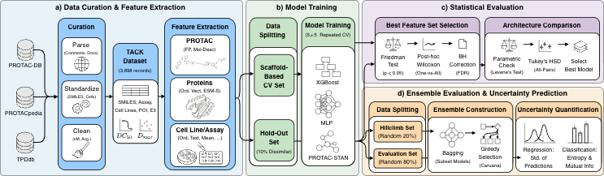

<h1 align="center">TACK</h1>

<h4 align="center"><i>A statistical evaluation of degradation activity on a novel TArgeting Chimeras Knowledge dataset</i></h4>

<p align="center">
  
</p>

<p align="center">
  <a href="https://arxiv.org/abs/2605.19579"></a>
  <a href="https://huggingface.co/datasets/ailab-bio/TACK"></a>
  <a href="https://huggingface.co/ailab-bio/TACK-Fast-Ensemble"></a>
  <a href="https://zenodo.org/records/15691822"></a>
  <a href="https://ribesstefano.github.io/TACK/"></a>
  <a href="LICENSE"></a>
  <!-- Add Colab banner -->
  <a href="https://colab.research.google.com/github/ribesstefano/TACK/blob/fast-surrogates/notebooks/fast_TACK_models_tutorial.ipynb"></a>
</p>

TACK predicts PROTAC-induced protein degradation — Dmax, DC50 and binary activity — from a
molecule plus its experimental context: target protein, E3 ligase, cell line, assay and
treatment time. The repository ships the curated dataset, its curation pipeline, and two sets
of pre-trained models.

## Quick start

The **fast ensembles** are the default way to run TACK: gradient-boosted ensembles over a
fused molecular + context design matrix. CPU only, no `torch`, milliseconds per molecule, and
molecules are featurised on the fly so unseen compounds can be scored.

```bash
git clone https://github.com/ribesstefano/TACK.git && cd TACK
uv venv --python 3.13 && source .venv/bin/activate
uv pip install -e .
```

```python
from tackai.fusion import FusionData, XGBStackedEnsemble

context_encoder = FusionData.from_pretrained("ailab-bio/TACK-Context-Encoding")
model = XGBStackedEnsemble.from_pretrained("ailab-bio/TACK-Fast-Ensemble", subfolder="dmax")

X = context_encoder.transform([{
    "smiles": "N#Cc1cccc(-c2ccc(=O)n(Cc3cccc(-c4ncc(OCC5CCN(CCCCC(=O)Nc6cccc7c6C(=O)N(C6CCC(=O)NC6=O)C7=O)CC5)cn4)c3)n2)c1",
    "poi_seq": "MKAPAVLAPGILVLLFTLVQRSNG...",  # target protein, full sequence
    "e3_seq": "MAGEGDQQDAAHNMGNHLPLLPAE...",   # E3 ligase, full sequence
    "cell_id": "CVCL_0333",                    # Cellosaurus accession
    "assay": "western blot",
    "assay_time": 72.0,                        # hours
}])

model.predict(X)  # {'mean': ..., 'std': ..., 'std_noise': ..., 'std_disagreement': ...}
```

| Task | `subfolder` | Output | Meaning |
|---|---|---|---|
| Max degradation | `dmax` | `mean` ∈ [0, 1] | Dmax as a fraction |
| Potency | `pdc50` | `mean` | −log₁₀(DC50 / M); 9.0 = 1 nM |
| Activity | `activity` | `proba` ∈ [0, 1] | P(Dmax > 80% and DC50 < 1 µM) |

Every prediction carries its own error bar, split into model noise and ensemble disagreement.
`FusionData.help()` and `XGBStackedEnsemble.help(show_extras=True)` describe the accepted
record fields, the cached vocabularies and every output key.

**Tutorial:** [`notebooks/fast_TACK_models_tutorial.ipynb`](notebooks/fast_TACK_models_tutorial.ipynb)
[](https://colab.research.google.com/github/ribesstefano/TACK/blob/fast-surrogates/notebooks/fast_TACK_models_tutorial.ipynb)

### Install options

| Command | Adds |
|---|---|
| `uv pip install -e .` | fast ensembles — `FusionData` + `XGBStackedEnsemble`, no `torch` |
| `uv pip install -e ".[training]"` | the legacy pipeline and the dataset curation scripts |
| `uv pip install -e ".[dev]"` | plotting, notebooks, `pytest` |
<!-- | `uv pip install -e ".[gp]"` | the GP surrogate (`FusionEnsemble`, `GPInteraction`) — needs `torch` | -->

Pre-computed context_encoder embeddings land in `TACKAI_CACHE` (copy `.env.example` to `.env` to set
it; default `~/.cache/tackai/`). On macOS, export `OMP_NUM_THREADS=1` before importing —
`torch` and `xgboost` bundle separate `libomp` copies and segfault when both run
multi-threaded in one process.

## Limitations of the fast ensembles

Please be aware of the following caveats when using the fast ensembles:

- **The context_encoder vocabularies are closed.** POI (protein of interest) and E3 blocks are keyed by the *exact* full
  amino-acid sequence, and an unseen sequence raises an error. A cell line must be a known Cellosaurus accession (blank falls back to *unknown*, an unrecognised accession raises). The assay vocabulary is
  closed; anything outside it falls back to *unknown* with a warning.
- **Predicitng outside the training domain is risky.** The model was trained on a limited set of POIs, E3 ligases, cell lines and assays, and the training set is heavily biased towards AR, BRD4, VHL and CRBN. Predictions for other targets or contexts might be unreliable. To register a new sequence embedding, i.e., 640-d ESM-2 embedding, use: `context_encoder.encoder.register_sequence()`. 
- **No check of PROTAC SMILES.** The model accepts any new PROTAC molecule, but does not check that the SMILES is a valid PROTAC-like structure. The training set is mostly bivalent molecules with a linker, but the model will happily "score" any small molecule resulting in a meaningless prediction.
- **Thresholds are fixed.** `activity` means Dmax > 80% *and* pDC50 > 6, hard-coded in
  `tackai.fusion.data`.
- **One timepoint, no kinetics.** `assay_time` is the mean of the reported DC50/Dmax hours and
  defaults to 24 h when absent.
- **Accuracy ceiling.** In 5×5 scaffold-grouped cross-validation the surrogate benchmark
  reaches R² ≈ 0.42 (Dmax), R² ≈ 0.55 (pDC50) and ROC-AUC ≈ 0.87 (activity). That is enough to
  rank PROTACs within a series; it does not replace a dose–response curve, and accuracy on
  unseen chemotypes is markedly lower than those numbers suggest.
- **Uncertainty is a hint, not a gate.** `std` widens outside the training domain, but nothing
  checks the applicability domain for you, and the conformal `lower`/`upper` bounds exist only
  for an ensemble that has been through `calibrate()`. The provided models are calibrated.
- **These are not the paper's models.** They are trained on an extended curation (~8.4k
  measurements) that is not yet published and not peer-reviewed. The results in the paper come
  from the legacy pipeline below.
- **Censored measurements are taken at face value.** During training, `DC50 > 10 µM` is read as 10 µM: the
  operator columns are ignored, and repeated measurements are not de-duplicated.

## Dataset

The curated dataset is on the Hub at
[`ailab-bio/TACK`](https://huggingface.co/datasets/ailab-bio/TACK):

```python
from datasets import load_dataset

dmax = load_dataset("ailab-bio/TACK", "Dmax", split="train")
dc50 = load_dataset("ailab-bio/TACK", "DC50", split="train")
multi = load_dataset("ailab-bio/TACK", "multitask", split="train")
```

It integrates TPDdb, PROTAC-DB and PROTACpedia with deduplication, POI/E3 normalisation and
scaffold clustering, and ships `SMILES_Held_Out`, `SMILES_Scaffold_Cluster` and
`SMILES_Butina_Cluster` columns so the held-out scaffolds never leak into training. To
re-run the curation, see [`tack_dataset/README.md`](tack_dataset/README.md).

## Reproducing the paper

The legacy pipeline is kept for reproducibility: Lightning/XGBoost models trained with
repeated 5×5 cross-validation and combined by Caruana's greedy forward selection.

```bash
uv pip install -e ".[dev,training]"
```

**Inference with the published ensembles.** Checkpoints and the shared embedding cache are on
Zenodo ([doi:10.5281/zenodo.15691822](https://doi.org/10.5281/zenodo.15691822)) as
`ensembles.zip` (per-task checkpoints, `_hparams.yaml`/`_state.pt` data-processing state and
`ensemble_weights_*.json`) and `cache.zip` (ESM protein, cell-line and molecular embeddings,
which must match the versions used during training). Unzip `cache.zip` and point
`TACKAI_CACHE` at it, or let the Hub do both:

```python
from tackai.ensemble_predictor import EnsemblePredictor

predictor = EnsemblePredictor.from_pretrained("ailab-bio/TACK-ensembles", subfolder="dmax_caruana")
result = predictor.predict({"SMILES": "CCO", "POI_Name": "BRD4", ...})
```

`from_pretrained` also takes a local directory, for compute nodes without outbound internet.
See [`notebooks/ensemble_predictor_tutorial.ipynb`](notebooks/ensemble_predictor_tutorial.ipynb).

**Training and evaluation.** Runs are composed with [Hydra](https://hydra.cc) from
`configs/train.yaml` by picking a feature set (`data=`, a file stem under `configs/data/`) and
a model (`model=`, a file stem under `configs/model/`); any leaf can be overridden inline.

```bash
tack train model=xgboost data=fp task=dmax group=scaffold    # one 5×5 CV experiment
tack collect --predictions-dir ./predictions                 # merge per-fold prediction CSVs
tack evaluate --predictions-dir ./predictions --output-dir ./evaluation
python scripts/ensemble_comparison.py --task dmax --prediction_dir ./predictions --output_dir ./ensemble_results
```

`tack evaluate` ranks methods per task with [`autorank`](https://github.com/sherbold/autorank)
and writes `report.md`, `ranking.csv`, `metrics.csv` and critical-difference diagrams. There
is no sweep subcommand — loop over configurations from the shell:

```bash
for enc in minmax onehot embedding; do
    tack train model=xgboost data=fp task=dmax data.categorical_encoding=$enc
done
```

Run identity is encoded in prediction filenames
(`preds-model=…-task=…-group=…-fold=…-split=….csv`) and in per-row `method`/`task`/`group`/
`fold`/`split` columns. Batch inference over a CSV of PROTACs:

```bash
tack predict --checkpoints-dir ensembles/dmax \
    --weights ensemble_weights_dmax_caruana_ensemble.json \
    --input-csv compounds.csv --output-csv predictions.csv
```

For the PROTAC-STAN baseline, see [`protac_stan/README.md`](protac_stan/README.md).

## Repository layout

```
TACK/
├── tackai/
│   ├── fusion/          # fast surrogates: design matrix, context encoder, ensembles
│   ├── data/            # legacy datamodule, tasks, embeddings
│   ├── models/          # MLP / BERT / multi-embedding backbones
│   ├── training/        # cross-validation, splitting, persistence
│   ├── evaluation/      # discovery, ranking, reports
│   └── cli.py           # tack train / predict / collect / evaluate
├── tack_dataset/        # dataset curation (scraping, dedup, clustering)
├── configs/             # Hydra configs for the legacy pipeline
├── notebooks/           # tutorials and the fusion experiment record
├── protac_stan/         # PROTAC-STAN baseline
├── scripts/             # ensemble selection and legacy helpers
└── test/                # pytest suite
```

To run the full test suite, install the dev dependencies and run:

```bash
OMP_NUM_THREADS=1 pytest    # the full suite needs ".[dev,gp,training]"
```

## License

MIT — see [`LICENSE`](LICENSE).

## Citation

```bibtex
@inproceedings{ribes_tack_2026,
	address = {New York, NY, USA},
	series = {{KDD} '26},
	title = {{TACK}: {A} {Statistical} {Evaluation} of {Degradation} {Activity} on a {Novel} {TArgeting} {Chimeras} {Knowledge} {Dataset}},
	isbn = {979-8-4007-2259-2},
	shorttitle = {{TACK}},
	url = {https://dl.acm.org/doi/10.1145/3770855.3819052},
	doi = {10.1145/3770855.3819052},
	urldate = {2026-10-12},
	booktitle = {Proceedings of the 32nd {ACM} {SIGKDD} {Conference} on {Knowledge} {Discovery} and {Data} {Mining} {V}.2},
	publisher = {Association for Computing Machinery},
	author = {Ribes, Stefano and Dunlop, Nils and Mercado, Rocío},
	month = aug,
	year = {2026},
	pages = {11912--11923},
	file = {Full Text PDF:/Users/ribes/Zotero/storage/QN359RNF/Ribes et al. - 2026 - TACK A Statistical Evaluation of Degradation Activity on a Novel TArgeting Chimeras Knowledge Datas.pdf:application/pdf},
}
```

## Acknowledgements

The authors acknowledge funding provided by the Chalmers Gender Initiative for Excellence
(Genie), and by the Wallenberg AI, Autonomous Systems, and Software Program (WASP), supported
by the Knut and Alice Wallenberg Foundation. The authors thank Yossra Gharbi, Alexander
Persson, and Felix Erngård for helpful discussions. The computations and data storage were
enabled by resources provided by Chalmers e-Commons and by the National Academic
Infrastructure for Supercomputing in Sweden (NAISS), partially funded by the Swedish Research
Council through grant agreement no. 2022-06725.
